# 🛡️ Project Aegis: Real-Time Fraud & Bot Swarm Detection Lakehouse


**Project Aegis** is an end-to-end, closed-loop data engineering and threat-mitigation pipeline built on **Databricks**, **Aiven Apache Kafka**, **FastAPI**, and **Supabase**. It ingests high-velocity social engagement telemetry alongside Change Data Capture (CDC) user profile updates, detects coordinated bot swarms and rapid account velocity anomalies in 1-minute tumbling windows, and automatically neutralizes offending bot accounts via REST API callbacks.

---

## 📌 Problem Statement

Modern social and marketplace platforms face two distinct automated abuse patterns that distort engagement metrics and degrade user trust:
1. **Coordinated Bot Swarms:** Dozens of low-trust accounts simultaneously targeting a single post within a sub-minute window to artificially inflate visibility.
2. **High-Velocity Account Bursts:** Individual automated scripts spamming interactions across multiple distinct posts at superhuman rates.

Traditional batch reporting identifies these anomalies hours later—after trending algorithms have already been manipulated. **Aegis** solves this by pairing **Spark Structured Streaming** with **closed-loop REST remediation**, detecting attacks and resetting offending account trust scores to `0.0` automatically.

---

## 🏗️ System Architecture

```mermaid
%%{init: {'theme': 'base', 'themeVariables': { 'primaryColor': '#1e293b', 'primaryTextColor': '#f1f5f9', 'primaryBorderColor': '#475569', 'lineColor': '#64748b', 'secondaryColor': '#0f172a', 'tertiaryColor': '#334155', 'fontFamily': 'Inter, system-ui, sans-serif' }}}%%
flowchart LR
    classDef source fill:#1e293b,stroke:#475569,color:#f1f5f9,stroke-width:1.5px;
    classDef broker fill:#0f172a,stroke:#38bdf8,color:#f1f5f9,stroke-width:1.5px;
    classDef lakehouse fill:#1e293b,stroke:#2dd4bf,color:#f1f5f9,stroke-width:1.5px;
    classDef quarantine fill:#1e293b,stroke:#94a3b8,color:#cbd5e1,stroke-dasharray: 4 4;
    classDef bi fill:#0f172a,stroke:#60a5fa,color:#f1f5f9,stroke-width:1.5px;

    Sim["traffic_simulator.py<br/>(Async Poisson + Bot Bursts)"]:::source
    Supa[("Supabase PostgreSQL<br/>(Users & Trust Scores)")]:::source
    API["main.py (FastAPI Webhook)<br/>(CDC Receiver)"]:::source

    Kafka{{"Aiven Apache Kafka<br/>telemetry_interactions | cdc_profiles"}}:::broker

    Bronze[("aegis.bronze<br/>(Append-Only Raw Delta)")]:::lakehouse
    Silver[("aegis.silver<br/>(Watermarked & Deduplicated)")]:::lakehouse
    DLQ[("aegis.silver.telemetry_quarantine<br/>(Malformed Event DLQ)")]:::quarantine
    Gold[("aegis.gold<br/>(1-Min Swarm & Velocity Alerts)")]:::lakehouse

    Dash["Databricks AI/BI Dashboard<br/>(Swarm & Velocity Monitor)"]:::bi

    Sim -->|Telemetry JSON| Kafka
    Supa -->|DB Webhook| API -->|CDC JSON| Kafka
    Kafka -->|availableNow Stream| Bronze
    Bronze -->|Valid Records| Silver
    Bronze -.->|Schema / Null Errors| DLQ
    Silver -->|1-Min Windows| Gold
    Gold -->|SQL Analytics| Dash
    Gold -.->|"PATCH trust_score = 0.0"| Supa
```



---

## ⚙️ Core Capabilities & Engineering Highlights

* **Dual-Stream Ingestion (Telemetry + CDC):**
  * `traffic_simulator.py` uses Python `asyncio` to generate Poisson-distributed organic user traffic interleaved with simulated bot swarm bursts and high-velocity spam attacks.
  * `main.py` exposes a deployed **FastAPI** webhook endpoint that receives real-time Supabase database webhooks whenever user profiles or trust scores change, publishing CDC payloads to Kafka (`cdc_profiles`).
* **Medallion Architecture Governed by Unity Catalog (`aegis`):**
  * **Bronze (`aegis.bronze`):** Append-only raw Kafka JSON landing tables backed by Unity Catalog managed checkpoint volumes (`/Volumes/aegis/bronze/checkpoints`) and Databricks Secret Scopes.
  * **Silver (`aegis.silver`):** Enforces event-time watermarking, stateful deduplication (`dropDuplicates` on `event_id`), and strict schema validation.
  * **Gold (`aegis.gold`):** Computes 1-minute tumbling window aggregations enriched with live user trust scores to isolate coordinated post swarms (`bot_swarm_alerts`) and rapid multi-post spammers (`account_velocity_alerts`).
* **Dead Letter Queue (DLQ) Observability:**
  * Corrupt JSON payloads, null primary keys, or invalid event timestamps are never silently dropped; they are routed to `aegis.silver.telemetry_quarantine` with failure metadata for root-cause auditing.
* **Closed-Loop Auto-Remediation:**
  * Within `05_Gold_Bot_Swarm_Detection.py`, a `foreachBatch` sink performs idempotent Delta `MERGE` upserts into Gold alert tables and fires authenticated `PATCH` requests to the **Supabase REST API**, automatically resetting offending bot `trust_score` values to `0.0`.
  * Subsequent CDC events confirm the mitigation back into `aegis.silver.user_profiles`, closing the feedback loop.

---

## ⚖️ Architectural Trade-Offs & Design Decisions

| Design Choice | Alternative Considered | Rationale |
| :--- | :--- | :--- |
| **`.trigger(availableNow=True)` on Serverless Compute** | Continuous 24/7 streaming cluster | Processes all queued Kafka offsets with full Structured Streaming checkpoint guarantees while eliminating idle cluster costs between scheduled workflow runs. |
| **Dedicated DLQ Table (`telemetry_quarantine`)** | `DROPMALFORMED` read mode | Preserves pipeline uptime during schema drift or malformed producer payloads while retaining 100% visibility into rejected events. |
| **Idempotent Delta `MERGE` in `foreachBatch`** | Direct `append` mode on windowed output | Prevents duplicate alert rows during stream retries or overlapping watermark updates while enabling schema evolution (`mergeSchema`). |
| **Closed-Loop REST `PATCH` Mitigation** | Passive BI alerting only | Cuts mean-time-to-mitigation (MTTM) from hours to seconds by neutralizing flagged accounts directly in the operational PostgreSQL database. |

---

## 📂 Repository Structure

```text
aegis-fraud-detection/
├── assets/                          # Dashboard, workflow DAG, and mitigation screenshots
├── dashboard/
│   └── aegis_dashboard.lvdash.json  # Exported Databricks AI/BI dashboard definition
├── databricks/
│   ├── 01_Bronze_Ingestion.py       # Kafka -> aegis.bronze.telemetry_interactions
│   ├── 02_Silver_Transformation.py  # Watermarking, deduplication & DLQ quarantine routing
│   ├── 03_Bronze_CDC_Profiles.py    # Kafka -> aegis.bronze.cdc_profiles
│   ├── 04_Silver_User_Profiles.py   # SCD Type 1 merge -> aegis.silver.user_profiles
│   └── 05_Gold_Bot_Swarm_Detection.py # 1-min swarm/velocity detection & Supabase PATCH
├── main.py                          # Deployed FastAPI Supabase CDC webhook receiver
├── traffic_simulator.py             # Async Poisson & bot swarm traffic generator
├── requirements.txt                 # Python dependencies for ingestion & webhook
├── .env.example                     # Environment variable template
├── .gitignore                       # Excludes .env, SSL certs (*.pem, *.cert, *.key)
└── README.md
```

---

## 🗄️ Unity Catalog Data Model

| Layer | Table Name | Description |
| :--- | :--- | :--- |
| **Bronze** | `aegis.bronze.telemetry_interactions` | Raw Kafka byte payloads, topic metadata, partition offsets, and ingestion timestamps. |
| **Bronze** | `aegis.bronze.cdc_profiles` | Raw Supabase user profile `INSERT` / `UPDATE` webhook payloads. |
| **Silver** | `aegis.silver.telemetry_interactions` | Cleaned, typed, and deduplicated user interaction events (`like`, `comment`, `share`). |
| **Silver** | `aegis.silver.telemetry_quarantine` | Dead Letter Queue capturing malformed records, raw payloads, and quarantine reasons. |
| **Silver** | `aegis.silver.user_profiles` | Latest state of user accounts, account age, and real-time `trust_score` (`0.0` – `1.0`). |
| **Gold** | `aegis.gold.bot_swarm_alerts` | 1-minute post-level aggregations flagging coordinated low-trust swarm attacks. |
| **Gold** | `aegis.gold.account_velocity_alerts` | 1-minute user-level aggregations flagging accounts exceeding velocity thresholds (`5+` actions/min). |

---

## 🚀 Setup & Reproducibility

### 1. Local Ingestion & Webhook Service
1. Clone the repository and install dependencies:
   ```bash
   git clone https://github.com/hanzzlah/aegis-fraud-detection.git
   cd aegis-fraud-detection
   pip install -r requirements.txt
   ```
2. Copy `.env.example` to `.env` and populate your credentials:
   ```bash
   cp .env.example .env
   ```
   *Required variables:* `AIVEN_BOOTSTRAP_SERVERS`, `SUPABASE_URL`, `SUPABASE_KEY`. Place your Aiven SSL files (`ca.pem`, `service.cert`, `service.key`) in the project root (ignored by Git).
3. Start the FastAPI CDC webhook receiver and run the traffic simulator:
   ```bash
   uvicorn main:app --host 0.0.0.0 --port 8000
   python traffic_simulator.py
   ```

### 2. Databricks Lakehouse & Workflow Configuration
1. Create the Unity Catalog hierarchy (`aegis.bronze`, `aegis.silver`, `aegis.gold`) and a managed volume `/Volumes/aegis/bronze/checkpoints`.
2. Store Aiven Kafka SSL certificates and Supabase credentials inside a Databricks Secret Scope named `aegis`.
3. Import the notebooks in `databricks/` (`01` through `05`) and configure the multi-task Databricks Workflow **`Aegis_Medallion_Pipeline`** on **Serverless** compute:
   * `01_Bronze_Ingestion` ➔ `02_Silver_Transformation` ↘
   * `03_Bronze_CDC_Profiles` ➔ `04_Silver_User_Profiles` ➔ `05_Gold_Bot_Swarm_Detection`
4. Import `dashboard/aegis_dashboard.lvdash.json` into **Databricks AI/BI Dashboards** and connect it to your SQL Warehouse.

---

## 📊 Observability & Visual Proof

> *Screenshots below capture live pipeline runs across Databricks AI/BI, Databricks Workflows, and Supabase.*

* **Databricks AI/BI Fraud & Swarm Analytics Dashboard:** Tracks total swarm hits, velocity alerts, targeted posts, average trust score, auto-mitigated bots, and DLQ quarantine count (`assets/dashboard_overview.png`).
* **Databricks Workflow DAG (`Aegis_Medallion_Pipeline`):** Multi-stage Serverless execution graph (`assets/workflow_dag.png`).
* **Closed-Loop Mitigation Verification:** Supabase table state showing flagged bot `trust_score` automatically reset to `0.0` (`assets/supabase_mitigation.png`).

---

## 🔮 Future Enhancements

* **ML-Based Anomaly Scoring:** Train an Isolation Forest / GBDT model in MLflow on historical Silver interaction intervals to complement rule-based 1-minute velocity thresholds.
* **Dead Letter Queue Replay Job:** Add an automated replay notebook to reprocess quarantined events once upstream producer schema patches are deployed.
* **CI/CD Asset Bundles:** Package notebooks, workflow definitions, and dashboard JSON using **Databricks Asset Bundles (DABs)** for automated staging-to-production promotion.